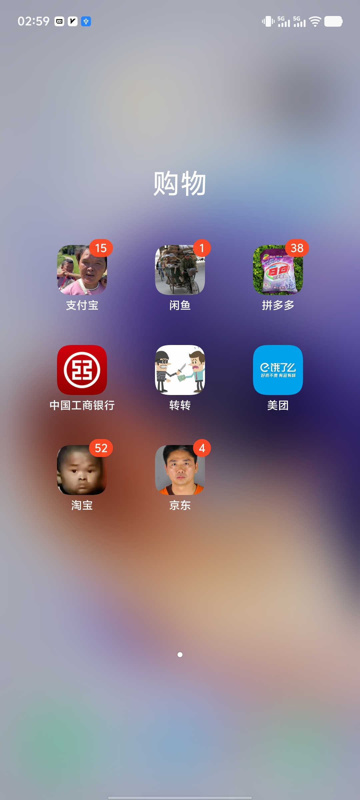

# change-icon-self

在 vivo / iQOO（OriginOS）上，不换主题、不刷机，把桌面图标批量换成自己的图片。

## 原理

脚本把你的图片按主题规范生成图标，注入当前已应用的第三方主题包（.itz），重新应用主题即生效。图标从此是主题资源的一部分：不会被系统回退，变形器调节图标大小也正常。

## 效果图

## 前提

1. 手机已 root（如 KernelSU），并授权 shell
2. 手机连电脑，已开启 USB 调试
3. 在 i主题 下载并应用**任意一个第三方主题**（系统默认主题不行）

## 用法

1. 首次使用运行 `install.sh`（自动安装 adb / python3 / Pillow）
2. 图片放到 icon 文件夹，按应用名命名：`QQ.jpg`、`微信.png`（正方形照片即可，无需透明背景）
3. 运行 `push_icons.sh`，mac 用户也可双击「应用自定义图标.command」
4. 按提示打开 i主题 → 我的 → 主题 → 重新应用该主题，图标即生效

脚本会自动识别当前应用的主题，无需任何配置。之后增改图标，重复第 2-4 步即可。

 

注意：

- 电话/联系人这种同包名双入口的，请将手机上 app 图标从 dock 栏拖到桌面上，才能看到名字（用看到的中文名命名图片）
- 主题从商店更新或重新下载会覆盖修改，重跑一次脚本即可
- 首次修改前，脚本自动把原主题包备份为 `主题名.itz.bak`；想彻底还原，在 i主题 重新下载该主题即可

## 免责

仅供个人学习与备份用途。操作涉及系统数据目录，请自行承担风险，先备份再动手。
